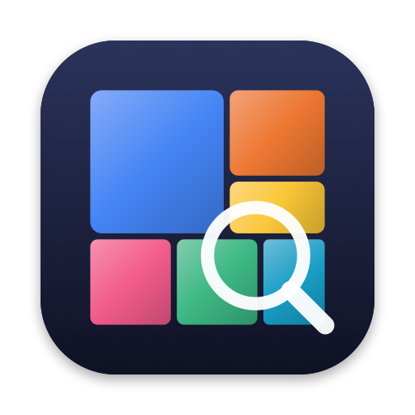

# DiskSeer

A native macOS app (SwiftUI, Swift 6.2+, macOS 26+) that shows what fills your disk, explains what every item is,
and helps you take the space back safely.



## Features

**See it**
- **Blocks (treemap)** — nested, squarified treemap with folder headers, cushion shading, hover tooltips,
  click to inspect, double-click to zoom, breadcrumbs, adjustable depth, free/hidden space blocks.
- **Rings (sunburst)** — DaisyDisk-style radial view of the same data.
- Color by **kind** (AI category), **age** (last change anywhere inside) or **top-level folder**.
- Sortable table of the current folder, live search across the whole scan.
- Overview dashboard: capacity bar by category, purgeable space, biggest folders, quick wins,
  **changes since the last scan** (history is stored per scanned root).

**Understand it — classification ("What is this?")**
1. **Knowledge base** of ~300 macOS / app / developer-tool locations (Xcode DerivedData, simulators, Homebrew,
   npm/pnpm/yarn/bun, Gradle, Maven, NuGet, Cargo, Go, pip/uv/conda, JetBrains, VS Code/Cursor, Docker Desktop,
   OrbStack, Colima, Podman, UTM/Parallels/VMware, iOS backups, Mail/Messages, Steam, AI model caches…).
2. **Context rules**: `target/` next to `Cargo.toml`, `bin/obj` next to a `.csproj`, `.venv` containing
   `pyvenv.cfg`, `Pods` next to a `Podfile`, Unity/Unreal caches, etc.
3. **Location inheritance** and **contents analysis** (a folder is what most of its bytes are).
4. **Predictive model**: a Naive Bayes classifier over path tokens, seeded with a built-in corpus and
   **self-trained on your own disk** from everything the knowledge base recognised; unknown words are mapped to
   known ones with Apple's on-device word embeddings (NaturalLanguage).
5. **Apple Intelligence** (FoundationModels, on-device): "Explain this item" second opinion and an
   automatically generated **cleanup plan** for the whole scan.

Every item shows its category, confidence, the evidence used, and whether it is safe to delete.

**Clean it**
- **Smart Clean**: findings grouped and ranked by safety (Safe / Review / Caution), sizes, explanations,
  one-click "Run cleanup" for proper tool commands (`brew cleanup`, `go clean -modcache`, `docker system prune`…),
  ignore list, CSV export. Includes caches, logs, build output, stale project dependencies (safe only when the
  project has not been touched for 30+ days), old installers, old downloads, forgotten folders, large unused files,
  old JetBrains IDE versions, unused apps, leftovers of uninstalled apps, the Trash.
- **Large & Old Files** with size, age and kind filters.
- **Duplicates**: size → partial SHA-256 → full SHA-256; "My files" scope skips app data, tools and caches.
- **Applications**: app + Library data size, last opened (Spotlight, or estimated from the app's own data),
  uninstall (app + its data), leftovers of removed apps.
- **Docker & VMs**: Docker.raw / OrbStack data.img / .vhdx / .qcow2 sizes, `docker system df`, prune actions.
- Menu bar extra with live free space, drag & drop a folder to scan it, Finder-like shortcuts.

## Safety

- DiskSeer **never deletes permanently**: everything goes through the Trash (Finder can restore it).
- A `SafetyPolicy` blocks system locations, essential folders, keychains, Mail, iCloud Drive, the inside of app
  bundles and Photos libraries, SSH keys, etc. Blocked items are skipped even if selected.
- Project-artifact rules only apply to *your* projects — never inside `~/Library`, hidden tool folders
  (`~/.vscode/extensions`, `~/.nvm`…), Homebrew or app bundles.
- Every removal and every command needs confirmation. Scanning only reads metadata.

## Build & run

```bash
swift test                 # 53 tests (scanner, classifier, analyzer, layouts, safety, duplicates…)
./scripts/build_app.sh     # builds dist/DiskSeer.app (release, ad-hoc signed, with icon)
open dist/DiskSeer.app
```

For a complete picture grant **Full Disk Access** (System Settings › Privacy & Security › Full Disk Access),
otherwise macOS hides folders such as other apps' containers.

There is also a command line companion:

```bash
swift run -c release diskseer-cli ~ --findings --apps --dupes --explain ~/Library/Caches
```

## Performance

Scanning uses `getattrlistbulk(2)` with a work-stealing pool of threads, counts allocated (on-disk) size, counts
hard links once and never follows symlinks or crosses volumes. On the development Mac a home folder with
1.1 M files scans in ~4.5 s; the whole data volume (1.65 M files) is scanned, classified and analysed in ~13 s
using ~520 MB of memory.

## Project layout

```
Sources/DiskSeerCore     scanner, classifier (knowledge base, rules, predictive model), analyzers,
                         treemap & sunburst layout, safety policy, cleanup engine
Sources/DiskSeer         SwiftUI app (views, model, Apple Intelligence, automation for screenshots)
Sources/diskseer-cli     command line companion
Tests/DiskSeerCoreTests  Swift Testing suite
scripts/                 app bundle + icon generation
```

### Automated screenshots

The app can drive itself for visual checks:

```bash
DISKSEER_SCAN=~ DISKSEER_SNAPSHOTS=overview,explorer,smartClean DISKSEER_SNAPSHOT_DIR=/tmp/shots \
DISKSEER_EXIT=1 dist/DiskSeer.app/Contents/MacOS/DiskSeer
```
